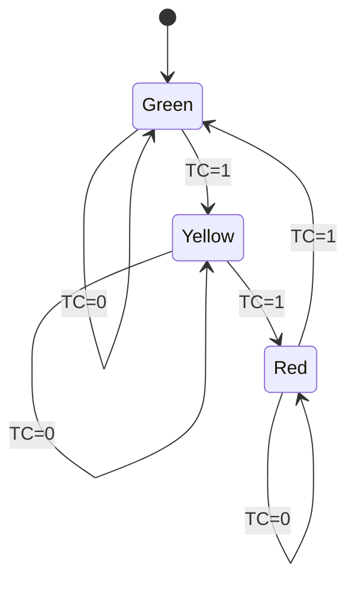

# Traffic-Light Controller + Mod-10 Counter

Digital logic capstone: a Moore-machine traffic-light controller timed by a synchronous mod-10 counter, designed with D flip-flops.

**Author:** _Your Name_  |  **Course:** Digital Logic Design

## 1. Overview

A free-running mod-10 counter acts as the timer. When it reaches 9, its terminal-count signal `TC` tells the traffic-light FSM to move to the next state. Each light therefore stays on for 10 clock ticks.

```
clk ──► [ Mod-10 counter ] ──TC──► [ Traffic-light FSM ] ──► Red / Yellow / Green
```

## 2. Mod-10 Counter (synchronous, D flip-flops)

Counts 0000 to 1001 and wraps to 0000. States 1010 to 1111 are unused (don't cares).

### State table

| Present Q3Q2Q1Q0 | Next Q3Q2Q1Q0 |
|---|---|
| 0000 | 0001 |
| 0001 | 0010 |
| 0010 | 0011 |
| 0011 | 0100 |
| 0100 | 0101 |
| 0101 | 0110 |
| 0110 | 0111 |
| 0111 | 1000 |
| 1000 | 1001 |
| 1001 | 0000 |

For a D flip-flop, the excitation is D = Q(next), so the D inputs equal the next-state columns.

### K-map simplified equations (using don't cares for 1010 to 1111)

- D0 = Q0'
- D1 = Q3'·Q1'·Q0 + Q1·Q0'
- D2 = Q2·Q1' + Q2·Q0' + Q2'·Q1·Q0
- D3 = Q3·Q0' + Q2·Q1·Q0
- **TC = Q3·Q0** (high only in state 1001, since 1011 and above never occur)

## 3. Traffic-Light FSM (Moore machine)

### State encoding

| State | s1 s0 | Output |
|---|---|---|
| Green (G) | 00 | Green on |
| Yellow (Y) | 01 | Yellow on |
| Red (R) | 10 | Red on |
| unused | 11 | don't care |

### State diagram



### State table

| Present s1s0 | TC | Next s1s0 |
|---|---|---|
| 00 (G) | 0 | 00 |
| 00 (G) | 1 | 01 |
| 01 (Y) | 0 | 01 |
| 01 (Y) | 1 | 10 |
| 10 (R) | 0 | 10 |
| 10 (R) | 1 | 00 |

### Flip-flop input equations (D flip-flops)

- D1 = s1·TC' + s0·TC
- D0 = s0·TC' + s1'·s0'·TC

### Output equations (Moore: depend on state only)

- Red = s1
- Yellow = s0
- Green = s1'·s0'

## 4. Verification (example run)

| Tick | Counter | TC | Light |
|---|---|---|---|
| 0 to 8 | 0 to 8 | 0 | Green |
| 9 | 9 | 1 | Green, then moves to Yellow |
| 10 to 18 | 0 to 8 | 0 | Yellow |
| 19 | 9 | 1 | Yellow, then moves to Red |
| 20 to 29 | 0 to 9 | 0 then 1 | Red, then back to Green |

## 5. Implementation

See [`traffic_light.v`](traffic_light.v) for a Verilog model. It can be simulated with Icarus Verilog or EDA Playground.

## 6. Possible extensions

- Different durations per state (for example a short yellow) by comparing the count to a per-state value.
- Make N a parameter to get any mod-N timer.
- Add a pedestrian-request input, which turns the Moore machine into a Mealy-style design.
